<!-- tailor:social-header:start -->
<p align="center">
  <a href="https://hue-jackman.wimpys.world"><picture><source media="(prefers-color-scheme: dark)" srcset="pages/social/hero-dark.svg"></picture></a>
</p>
<!-- tailor:social-header:end -->

<!-- tailor:social-links:start -->
<p align="center">
  <a href="https://bsky.app/profile/wimpys.world"><picture><source media="(prefers-color-scheme: dark)" srcset="pages/social/link-bluesky-dark.svg"></picture></a>
  <a href="https://wimpysworld.social/@martin"><picture><source media="(prefers-color-scheme: dark)" srcset="pages/social/link-mastodon-dark.svg"></picture></a>
  <a href="https://linkedin.com/in/martinwimpress"><picture><source media="(prefers-color-scheme: dark)" srcset="pages/social/link-linkedin-dark.svg"></picture></a>
</p>
<!-- tailor:social-links:end -->

<!-- tailor:social-community:start -->
<p align="center">
  <a href="https://discord.com/invite/vUsydfP"><picture><source media="(prefers-color-scheme: dark)" srcset="https://raw.githubusercontent.com/wimpysworld/hue-jackman/social-assets/community-dark.svg"></picture></a>
</p>
<!-- tailor:social-community:end -->

`hue-jackman` is a Linux command-line tool that controls Chroma RGB lighting on the Razer Wolverine V2 Chroma (`1532:0a2e`). It speaks directly to Linux `usbdevfs` in pure Go with no CGo or `libusb` dependency, detaches `xpad` while sending commands, and reattaches `xpad` on exit.

It supports whole-controller effects, brightness, device info queries, and independent 24-bit RGB control of the left and right light strips.

## Features

- **Independent two-segment RGB**: address the left strip (`row 0, col 0`) and right strip (`row 0, col 1`) separately with 24-bit colours through Extended Matrix Custom Frame mode (`0x0f 0x03`).
- **Built-in Chroma effects and brightness**: set one solid colour, single-colour or two-colour breathing, spectrum cycling, off, and brightness (`0` to `255` on `led_id 0x05`).
- **Controller inspection and raw commands**: read firmware version, serial number, device name, and active profile, or send arbitrary `0x0f` vendor commands with `--dry-run` and `--verbose`.
- **Clean `xpad` hand-off**: detaches `xpad` from interface `0` while sending frames and reattaches it on exit so the gamepad keeps working.
- **Single static Go binary**: built with `CGO_ENABLED=0` and the Go standard library only, with no `libusb`, background daemon, or custom kernel module.

<!-- tailor:social-stats:start -->
<p align="center">
  <a href="https://github.com/wimpysworld/hue-jackman/pulse"><picture><source media="(prefers-color-scheme: dark)" srcset="https://raw.githubusercontent.com/wimpysworld/hue-jackman/social-assets/stats-dark.svg"></picture></a>
</p>
<!-- tailor:social-stats:end -->

## Install

First-party signed package repositories are published for Linux and Nix through [wimpys.world](https://wimpys.world/). Choose your distribution below for setup instructions and automatic updates.

<!-- tailor:social-packages:start -->
<p align="center">
  <a href="https://apt.wimpys.world/#hue-jackman"><picture><source media="(prefers-color-scheme: dark)" srcset="pages/social/pkg-apt-dark.svg"></picture></a>
  <a href="https://rpm.wimpys.world/#hue-jackman"><picture><source media="(prefers-color-scheme: dark)" srcset="pages/social/pkg-rpm-dark.svg"></picture></a>
  <a href="https://pkg.wimpys.world/#hue-jackman"><picture><source media="(prefers-color-scheme: dark)" srcset="pages/social/pkg-pkg-dark.svg"></picture></a>
  <br>
  <a href="https://apk.wimpys.world/#hue-jackman"><picture><source media="(prefers-color-scheme: dark)" srcset="pages/social/pkg-apk-dark.svg"></picture></a>
  <a href="https://nix.wimpys.world/#hue-jackman"><picture><source media="(prefers-color-scheme: dark)" srcset="pages/social/pkg-nix-dark.svg"></picture></a>
</p>
<!-- tailor:social-packages:end -->

<details>
<summary><strong>Any Linux (<code>bin</code>)</strong> - install and update the release binary directly</summary>

[bin](https://github.com/marcosnils/bin) installs and updates the release binary:

```sh
bin install github.com/wimpysworld/hue-jackman
```

</details>

<!-- tailor:social-sponsors:start -->
<p align="center">
  <a href="https://github.com/sponsors/flexiondotorg"><picture><source media="(prefers-color-scheme: dark)" srcset="pages/social/sponsors-dark.svg"></picture></a>
</p>
<!-- tailor:social-sponsors:end -->

## Quick start

```bash
# Inspect connected controllers (firmware, serial, device name, active profile)
hue-jackman

# Set the left and right light strips independently (left red, right blue)
hue-jackman rgb segments FF0000 0000FF

# Set both strips to one solid colour
hue-jackman rgb static FF00FF

# Set 1-colour or 2-colour breathing, spectrum cycling, brightness, or off
hue-jackman rgb breathe 00FF00 FF00FF
hue-jackman rgb spectrum
hue-jackman brightness 128
hue-jackman rgb off
```

<!-- tailor:social-demo:start -->
<p align="center">
  <picture><source media="(prefers-color-scheme: dark)" srcset="pages/social/demo-dark.svg"></picture>
</p>
<!-- tailor:social-demo:end -->

Pass `--device <N>` when multiple controllers are connected, `--dry-run` to print encoded 64-byte frames without touching USB, or `--verbose` to log raw TX and RX frames to `stderr`. Run `hue-jackman <command> --help` for full values and options.

| Command | Action |
| --- | --- |
| `hue-jackman` | Inspect connected controllers (alias: `hue-jackman info`) |
| `hue-jackman rgb segments <LEFT> <RIGHT>` | Set left (`col 0`) and right (`col 1`) strips independently (`RRGGBB`) |
| `hue-jackman rgb static <RRGGBB>` | Set both strips to one solid colour |
| `hue-jackman rgb breathe <RGB1> [RGB2]` | Set 1-colour or 2-colour breathing (alias: `breathing`) |
| `hue-jackman rgb spectrum` | Enable spectrum cycling |
| `hue-jackman rgb off` | Turn Chroma lighting off |
| `hue-jackman brightness <0-255>` | Set Chroma brightness (`led_id 0x05`) |
| `hue-jackman raw <class> <cmd> [hex...]` | Send an arbitrary `0x0f` vendor command |

## USB permissions

By default, `/dev/bus/usb/*` for `1532:0a2e` has no `uaccess` tag, so running without `sudo` fails with permission denied. To grant access to your desktop session, add a udev rule such as `/etc/udev/rules.d/99-hue-jackman.rules`:

```udev
SUBSYSTEM=="usb", ATTR{idVendor}=="1532", ATTR{idProduct}=="0a2e", TAG+="uaccess"
```

Reload udev rules and replug the controller (or trigger udev):

```bash
sudo udevadm control --reload-rules && sudo udevadm trigger
```

## Protocol summary

The Wolverine V2 Chroma exposes Xbox One Game Input Protocol (GIP) interfaces (`ff/47/d0`) with no USB HID interface. `hue-jackman` sends 64-byte GIP vendor frames on interface `0` interrupt endpoints `0x01` (OUT) and `0x81` (IN):

- Bytes `0x00..0x03`: GIP header (`0x0f` request or `0x10` reply, flags `0x00`, rolling sequence byte, length `0x3c`).
- Bytes `0x04..0x3f`: 60-byte Razer report (`status`, `transaction_id 0x1f`, `data_size`, `command_class`, `command_id`, up to 50 argument bytes, XOR checksum of `0x06..0x3d` at `0x3e`, reserved `0x00`).
- Presets and brightness use Extended Matrix class `0x0f` (`cmd 0x02` effect, `cmd 0x04` brightness on `led_id 0x05`).
- Independent two-segment control switches to Extended Matrix Custom Frame mode (`0x0f 0x02`, `effect_id 0x08`) and writes row `0`, columns `0..1` via `0x0f 0x03`.

## Development

### Build from source

Build a static binary with Go:

```bash
CGO_ENABLED=0 go build -o bin/hue-jackman ./cmd/hue-jackman
```

If you use the Nix development shell and `just`, run:

```bash
just build
```

## Support and contributing

Read [Support](SUPPORT.md) for help and [Contributing](CONTRIBUTING.md) before submitting a change.

<!-- tailor:social-stars:start -->
<p align="center">
  <a href="https://github.com/wimpysworld/hue-jackman/stargazers"><picture><source media="(prefers-color-scheme: dark)" srcset="https://raw.githubusercontent.com/wimpysworld/hue-jackman/social-assets/stars-dark.svg"></picture></a>
</p>
<!-- tailor:social-stars:end -->

<!-- tailor:social-contributors:start -->
<p align="center">
  <a href="https://github.com/wimpysworld/hue-jackman/graphs/contributors"><picture><source media="(prefers-color-scheme: dark)" srcset="https://raw.githubusercontent.com/wimpysworld/hue-jackman/social-assets/contributors-dark.svg"></picture></a>
</p>
<!-- tailor:social-contributors:end -->

<!-- tailor:social-footer:start -->
<p align="center">
  <a href="https://tailor.wimpys.world"><picture><source media="(prefers-color-scheme: dark)" srcset="pages/social/footer-dark.svg"></picture></a>
</p>
<!-- tailor:social-footer:end -->
